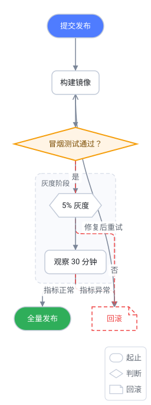

# FlowChart — DeepSeek Harness 对话流程图插件

[](https://github.com/Oliver13211)
[](#开发与测试)

当代理的文字解释难以理解时，代理调用 `FlowChart` 工具，用一段 YAML 描述流程图；插件把这张图渲染到对话右侧边栏的独立标签页里——形状、方向、颜色、连线、文字，直接看懂结构。对话内同时出现一张带缩略图的卡片，点开即回边栏。



## 功能

- **YAML DSL**：15 种形状（起止/判断/存储/文档/外部…）、四向布局（TB/BT/LR/RL）、
  自定义填充与描边（默认带 1.5px 描边，三种写法可关）、连线带文字与箭头（5 种箭头 ×
  4 种方向 × 3 种线型）、分组框、图例。上限保护：60 节点 / 120 边 / 20000 字符。
- **四层校验**：词法（Tab/缩进定位到行）→ 结构（拼错枚举给 "did you mean" 提示，
  含别名表 `rhombus→diamond`）→ 图语义（孤立点/自环/环均为警告，闭环边自动绕行）→
  容量。错误信息永远可操作：`line N · path: message — hint`。
- **边栏面板**：滚轮缩放、拖拽平移、双击适应、方向临时切换、多图切换、
  导出（复制 SVG / 下载 SVG / 下载 PNG）。明暗主题自动跟随宿主。
- **对话内卡片**：标题 + `N 节点 · M 连线` + 缩略图 + 「在右侧边栏打开」；
  校验失败显示前 3 条错误，帮用户理解代理为什么在重试。
- **可复现**：图内容来自会话日志的投影折叠（projection fold），重启/恢复后原样重建；
  `file` 来源以调用时快照持久化，文件后续改动不影响已出的图。
- **同 id 替换**：代理迭代修图时版本 +1 就地更新，不堆标签页。
- **双语**：中文/英文界面文案，跟随宿主 locale。

## 安装

### 方式一：从本地目录（开发态）

```bash
git clone https://github.com/Oliver13211/dsh-plugin-flowchart.git
cd dsh-plugin-flowchart
npm install   # 可跳过：本插件零运行时依赖，install 只为工具链
```

然后在 DeepSeek Harness 的插件管理里以本地路径挂载，或直接把本目录作为
profile 的链接依赖：

```json
{ "@local/dsh-plugin-flowchart": "link:/absolute/path/to/dsh-plugin-flowchart" }
```

### 方式二：打包为 bundle zip

```bash
npm pack
```

将得到的 `.tgz` 通过 Harness 插件市场的「安装本地包」入口安装。

### 配置

| 键 | 默认 | 说明 |
|---|---|---|
| `autoOpen` | `true` | 新图自动展开右侧边栏 |
| `defaultDirection` | `TB` | 文档未写 `direction` 时的方向 |
| `maxNodes` / `maxEdges` / `maxYamlChars` | 60 / 120 / 20000 | 容量上限 |
| `showLegendByDefault` | `false` | 自动从用到的形状合成图例 |
| `export.svg` / `export.png` | `true` / `true` | 导出菜单里的格式开关 |

## 使用

对代理说人话即可——解释里出现步骤、分支、循环、状态流转、调用链时，
代理会自己决定调用 `FlowChart`。也可以直接让它画：

> 用 FlowChart 把这段部署流程画出来

模型可见的调用示例（`yaml` 内联与 `file` 读工作区文件二选一）：

```yaml
id: deploy            # 同 id 重发 = 替换（版本 +1）
title: 灰度发布流程
direction: TB
nodes:
  - { id: start, label: 提交发布, shape: stadium, fill: "#4f7cff" }
  - { id: gate,  label: 冒烟通过?, shape: diamond, fill: "#fff4e5", stroke: "#f59e0b" }
  - { id: roll,  label: 回滚, shape: note, dashed: true, stroke: "#ef4444" }
edges:
  - { from: start, to: gate }
  - { from: gate, to: roll, label: 否, style: dashed, color: "#ef4444" }
groups:
  - { id: ci, label: 灰度阶段, members: [gate], style: dashed }
legend:
  - { shape: diamond, label: 判断 }
```

## 架构

一个 Cordis bundle，两半：

```
index.js               Host 半：工具注册、file 读取、Config、投影注册
lib/dsl.js             YAML 子集解析（行/列定位，Tab 与缩进翻译成可操作提示）
lib/normalize.js       第 2–4 层校验 + 归一化 → Client 直接渲染的文档
lib/projection.js      会话投影：从事件流折叠出图清单（key=flowchart, stateVersion=2）
lib/metrics.js         文本度量与换行（CJK 1.0em / 拉丁 0.55em，可注入 measureText）
lib/layout.js          九步布局：分层 → barycenter → 坐标 → 锚点 → 路由 → 组框 → 视图盒
lib/svg.js             15 种形状、箭头、主题 token 解析、图例（纯函数，字符串输出）
client/ui.js           边栏面板 + 工具卡片 + 导出交互（普通 ESM，Node 可直接测）
client.js              生成物：browser 模块系统要求单文件，由 build 脚本内联
scripts/build-client.mjs
```

设计约束（也是踩过坑后的硬规则）：

- **零运行时依赖**：YAML 子集解析、布局、渲染全部自写；不 import 任何
  `@deepseek-ai/*`（链接的本地 bundle 解析不到 app 树）。
- **布局是纯函数**：无随机、无时钟，同一文档任何设备同一几何。
- **投影永不抛错**：注册表在 live drive 和 restore 两条路径上都不守卫，
  投影抛错 = 会话不可用。本插件三层防抛（sanitize / try-catch / fail-soft schema），
  任何情况下只降级为"图暂时不对"，不拖垮宿主。
- **Client 半是生成物**：浏览器模块系统按包 id 解析、相对 import 无解析器，
  改完源码必须 `npm run build:client`（`npm test` 会检查生成物是否落后）。

## 开发与测试

```bash
npm test              # 8 套测试 199 条：DSL / 校验投影 / 布局 / 渲染 / 工具契约
                      #   / M4 打磨 / 持久化回放 / 客户端组件 / 客户端 bundle
npm run build:client  # 改过 lib/*.js 或 client/ui.js 后必须跑
npm run samples       # 重新生成 samples/*.svg（人眼复核用）
```

持久化测试直接回放真实会话日志：从投影缓存行播种、折叠尾部，与全量折叠
逐字节对比——这就是"重启会话后图仍在"的验收。

## 文档

完整设计文档（DSL 规范、校验分层、数据流、决策记录与踩坑史）见
[flowchart-plugin-design.md](../flowchart-plugin-design.md)，或仓库根的
[DESIGN.md](DESIGN.md)（同一份文档的随仓库副本）。要紧的几节：

- §6 DSL 规范 —— 所有字段与上限
- §7 校验与错误反馈 —— 错误信息的形状
- §18.2 实现期补充决策 —— 9 处"照文档原文写会坏"的地方及理由
- §20.3 故障排查 —— 工具消失 / 会话不可用 / 导出全黑等实测故障

## License

MIT
